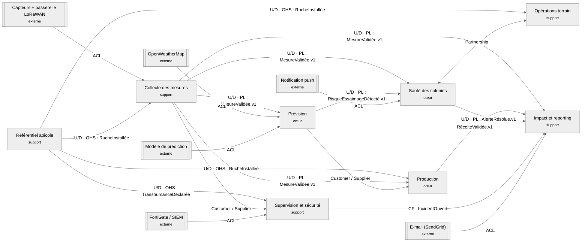

# Context map QueenBee · groupe Data

## Relations
| Amont | Aval | Relation | Échange | Justification |
|---|---|---|---|---|
| Capteurs + passerelle LoRaWAN | Collecte des mesures | ACL | Trames LoRaWAN | Format radio externe (champs, unités, encodage) traduit en `LotDeTrames` |
| Référentiel apicole | Collecte des mesures | U/D · OHS | `RucheInstallée`, `TranshumanceDéclarée` | La collecte rejette une trame d'une ruche inconnue et compare la position GPS à la position de référence |
| Référentiel apicole | Opérations terrain | U/D · OHS | `RucheInstallée` | Une inspection ou une visite ne porte que sur une ruche existante |
| Référentiel apicole | Production | U/D · OHS | `RucheInstallée` | Une récolte ne peut être déclarée que pour une ruche existante |
| Référentiel apicole | Supervision et sécurité | U/D · OHS | `TranshumanceDéclarée` | Un déplacement n'est « non déclaré » que s'il n'y a pas de transhumance (UC-CY04) |
| Collecte des mesures | Prévision | U/D · PL | `MesureValidée.v1` | Les mesures alimentent le score de santé, le risque et la prédiction de rendement (contrat dans `specialite/data-contrat-mesure-validee.md`) |
| Collecte des mesures | Santé des colonies | U/D · PL | `MesureValidée.v1` | Suivi de l'état des colonies |
| Collecte des mesures | Production | U/D · PL | `MesureValidée.v1` | Le coordinateur compare la récolte aux poids mesurés (UC-C02) |
| Collecte des mesures | Impact et reporting | U/D · PL | `MesureValidée.v1` | Indicateurs multi-sites (UC-G01) |
| Collecte des mesures | Supervision et sécurité | Customer / Supplier | `PasserelleHorsLigneDétectée`, `TrameRejouéeDétectée`, `PositionHorsToléranceDétectée` | La supervision exprime les signaux dont elle a besoin (UC-CY01, UC-CY02, UC-CY04), la collecte les planifie |
| OpenWeatherMap | Prévision | ACL | Météo par site | API externe (lat/lon, Kelvin, date Unix) traduite dans le modèle de la prévision |
| Modèle de prédiction | Prévision | ACL | Score, risque, rendement | Le modèle peut changer de version ou de format sans toucher `EvaluationRisque` |
| Prévision | Santé des colonies | U/D · PL | `RisqueEssaimageDétecté.v1`, `ScoreSantéRecalculé.v1` | Santé ne lève une alerte qu'à partir d'un risque publié |
| Prévision | Production | Customer / Supplier | `PrédictionRendementCalculée` | Production a besoin d'une prédiction par ruche et par saison pour calculer l'écart |
| Santé des colonies | Opérations terrain | Partnership | `AlerteLevée`, `AlerteEscaladée`, `AlerteAnnulée` / `InspectionSynchronisée` | Les deux contextes dépendent l'un de l'autre : une alerte déclenche une visite (annulée si fausse alerte), une inspection résout l'alerte |
| Notification push | Santé des colonies | ACL | Envoi push | Service externe isolé derrière un port de notification |
| Production | Impact et reporting | U/D · PL | `RécolteValidée.v1` | Seules les récoltes validées entrent dans les indicateurs de rendement |
| Santé des colonies | Impact et reporting | U/D · PL | `AlerteLevée.v1`, `AlerteRésolue.v1`, `AlerteAnnulée.v1` | Indicateur « colonies à risque » (les fausses alertes n'y sont pas comptées) |
| Supervision et sécurité | Impact et reporting | CF | `IncidentOuvert` | Impact reprend tel quel les incidents pour l'indicateur « couverture réseau » |
| E-mail (SendGrid) | Impact et reporting | ACL | Envoi du rapport au bailleur | Service externe isolé derrière un port d'envoi |
| FortiGate / SIEM | Supervision et sécurité | ACL | Journaux | Format des journaux externes traduit en `Incident` |
